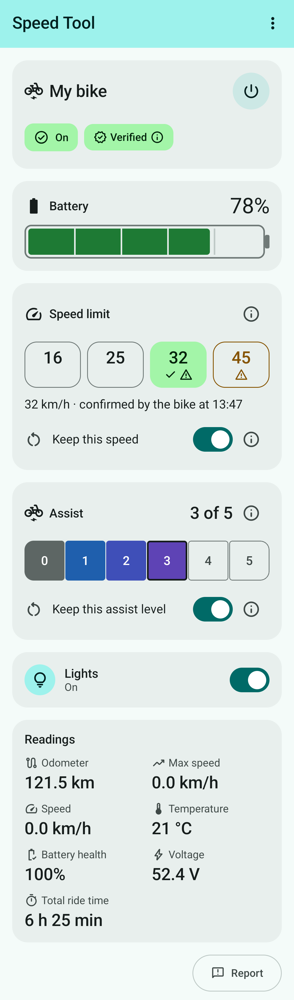
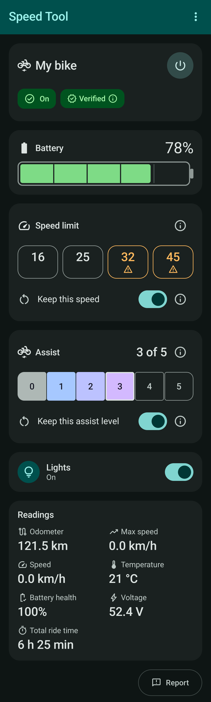

# ENGWE Speed Tool (Unofficial)

[](https://github.com/ridelabz/engwe-speed-tool/actions/workflows/ci.yml)
[](LICENSE)

A free, open-source Android app that sets the motor-assistance speed limit of ENGWE e-bikes that use its
Bluetooth protocol (verified on the E26 3.0 Pro), and shows the bike's readings. **Unofficial:** not made by, endorsed by or affiliated with ENGWE.

**Status:** 1.0.0 is the first release: [Releases](https://github.com/ridelabz/engwe-speed-tool/releases).

<p align="center">
  
  
</p>

## Legal & safety

In the EU and many other countries, an e-bike must stop assisting at 25 km/h; above that, it may legally be
a moped that needs approval, registration, insurance, a licence and a helmet. Use settings above 25 km/h
only where it is legal, for example on private land. Higher speeds increase the risk of accidents, injury
and damage, a change may void your warranty and affect your insurance, and you use the app at your own
risk. The full text, which the app asks you to accept: [SAFETY.md](SAFETY.md).

## Why this exists

On our ENGWE E26 3.0 Pro, the display offered a choice between 25 and 32 km/h. After the IoT firmware
update **218CAN**, that choice was gone, and the alternatives we found were paid or closed. This project
documents the bike's Bluetooth protocol from its own observations ([PROTOCOL.md](PROTOCOL.md)) and offers a
free, open, community-maintained app.

## What it does

- Finds your bike, checks that it speaks the protocol, and reads its model (it never pairs a bike itself).
- Shows the bike's readings: speed, battery, assist level, odometer, lights and more.
- Sets the assistance limit to **16, 25, 32 or 45 km/h** (with a warning above 25 km/h), and switches the
  lights. Going back to 25 km/h is always one tap.
- Sets the assist level (0 to 5 on the E26 3.0 Pro), shown as set only once the bike shows the new level.
- Turns the bike off and on (E26 3.0 Pro) by locking and unlocking it, as the ENGWE app's lock button does;
  off only while the bike reads 0 km/h. In the project's tests, turning it off and on from the app reset the
  limit to 25 km/h, as switching it off and on at the display does.
- Optionally sets your speed, and your assist level, again when the app reconnects and, on the E26 3.0 Pro,
  after the bike is switched off and on, while the app is open ("Keep this speed" and "Keep this assist
  level", off by default; at most once a minute; the assist level only while the bike reads 0 km/h; keeping
  the assist level not yet tried on the bike).
- Keeps session logs on the phone and lets you preview and save one to attach to a report.
- Runs a read-only compatibility check, whose result you can report or share as text, and a demo mode with
  a simulated bike.

It doesn't change firmware, motor current or any other setting, and it has no account and no internet
access.

## Compatibility, and an important caveat

- **Verified:** ENGWE E26 3.0 Pro with IoT firmware **218CAN**. In the project's tests, the limit went back
  to 25 km/h when the bike was switched off and on at its display (after setting 16, 32 and 45 km/h), and
  from the app (after setting 32 km/h). The app can't read
  the firmware version, so it shows any bike that reports the E26 3.0 Pro's model identity as verified:
  check its IoT firmware version in the ENGWE app.
- **Unknown:** other firmware versions and other models. A change might behave differently there, including
  being **permanent** (staying after the bike is switched off). Always tap 25 when you're done, and please
  report what you see.

The details, and how a model gets verified: [COMPATIBILITY.md](COMPATIBILITY.md).

## Install

Download the APK from the [Releases](https://github.com/ridelabz/engwe-speed-tool/releases) page and check
it against the release's `SHA256SUMS` (for example `sha256sum -c SHA256SUMS` with both files in one
folder). The app needs Android 12 or later and Bluetooth LE. Every release is signed with the project's
release key, whose certificate's SHA-256 fingerprint is:

```
4a632f2300400f1ac3035410a60b8a6b03c551fca2d4b36087687899129e4169
```

Check an APK with `apksigner verify --print-certs` (part of the Android SDK build tools) before installing
it: its "certificate SHA-256 digest" must be this one.

Every pull request also gets a **test build**: a bot comments with its download link and checksum. Test
builds install next to the release app (their own app ID), show a permanent "TEST BUILD · PR #n · not
reviewed" banner and are signed with a public test key. **They are not reviewed:** install one only if you
trust the change. Changes to protected parts (the bike communication, the safety text, the build) get their
test build only after a maintainer's review.

## Help verify your bike

If you ride a model or firmware that isn't verified yet, your report helps: tell the project how the app
worked on your bike with the issue form **How it worked on my bike**, and attach the session log after
checking what it contains. Ride only where it is legal, for example on private land. A model is verified
with at least two independent reports (different riders and bikes), each with a log and assistance stopping
within ±2 km/h with the limit set to 32 km/h, and the dashboard's values checked against the bike's display
or the ENGWE app ([COMPATIBILITY.md](COMPATIBILITY.md)).

## Support

This project is **community-supported: there is no individual support.** Ask questions in Discussions;
see [SUPPORT.md](SUPPORT.md).

## Privacy

- The app has no internet permission. Nothing leaves your phone unless you choose to share it (a log you
  save, a report you open in the browser, a check result you share). Logs you save go to the phone's
  Downloads folder, where apps with access to your files (all-files access, or the storage permission in
  older apps) and backup or sync apps that copy Downloads can read them: delete one once it is attached.
- The app removes Bluetooth addresses, the serial numbers it recognises, names and the time of day from
  session logs. It can't always tell whether a bike added its serial number to the model text, so check
  the model in the preview before you save a log. Logs also hold the date, the phone's maker and model, ride
  data such as the odometer (which can link reports from the same bike) and, after a compatibility check,
  the Bluetooth services the bike declares (custom ones shortened).
- The app's data is excluded from backups and device transfer.

## Contributing

See [CONTRIBUTING.md](CONTRIBUTING.md) (building, safety rules for changes, adding a bike) and the
[code of conduct](CODE_OF_CONDUCT.md).

## Licence

[GPL-3.0](LICENSE). ENGWE is a trademark of its owner; this project is not affiliated with ENGWE.
